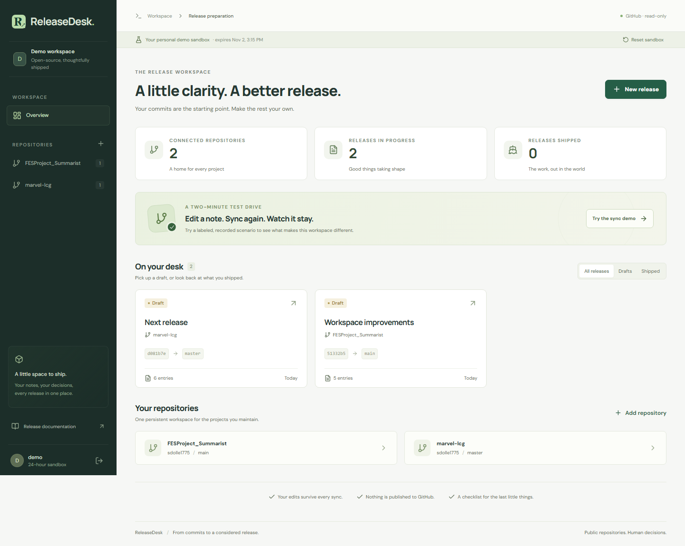
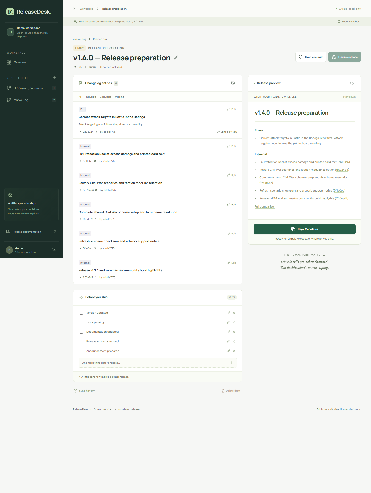
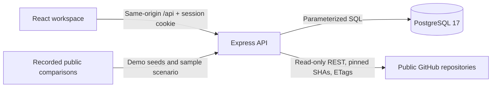
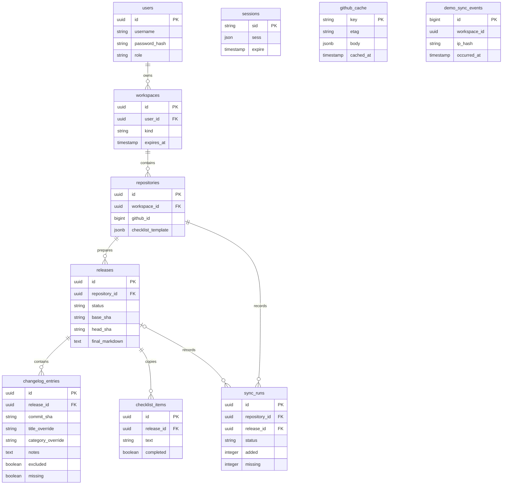

# ReleaseDesk

[](https://github.com/sdolle1775/releasedesk/actions/workflows/ci.yml)

A release preparation workspace for open-source maintainers. Turn public GitHub commits into persistent, editable release notes, keep your decisions through every sync, and work through the last checks before shipping.

**Live demo:** deployment is awaiting owner configuration of Render and Neon. See the [deployment runbook](docs/operations.md). The complete application runs locally using either command below; demo credentials are **`demo` / `releasedesk`**.

## What it does

- Connect a public repository and select a base and head tag, branch, or SHA.
- Rewrite entries, change categories, add notes, or exclude commits.
- Sync additional commits without losing editorial decisions or checklist changes.
- Review commits that disappear after history changes; edits are retained.
- Preview and copy the exact Markdown generated by the server.
- Complete a readiness checklist and finalize an immutable release snapshot.
- Browse finalized history alongside drafts for every connected repository.
- Try live public imports in an isolated 24-hour demo workspace, or use the labeled recorded sync demonstration without a GitHub token.

GitHub already generates release notes and supports categories and exclusions. ReleaseDesk adds a persistent structured workspace: editorial decisions that survive synchronization, readiness checklists, and a history of the notes you actually shipped. It does not publish to GitHub.



## Stack

React, TypeScript, Vite, React Router, TanStack Query, CSS Modules, Express 5, Zod, PostgreSQL 17, node-postgres, SQL migrations through node-pg-migrate, Argon2id, PostgreSQL-backed sessions, Vitest, Supertest, Playwright, Docker, and GitHub Actions. Fonts are bundled locally. The API serves the built frontend in production.

## Quick start: without Docker

Requires Node.js **24.22.2** and npm. Run from the repository root:

```sh
npm ci
npm run dev:local
```

Open [http://localhost:5173](http://localhost:5173) and choose **Open demo workspace**. The helper starts real PostgreSQL 17 on loopback port 54329, creates the local databases, builds the shared contracts, and starts the API and Vite. It creates an ignored `.env` with a random session secret if one does not exist. Database files live in ignored `.local/postgres`; Ctrl+C stops services launched by the helper.

Set a server-side `GITHUB_TOKEN` in `.env` for reliable live imports. Without a token, GitHub's unauthenticated limits apply. The recorded sync demonstration needs no token.

For your own persistent workspace, set `OWNER_USERNAME` and an `OWNER_PASSWORD` of at least 12 characters in `.env`, then restart the API or run `npm run db:seed`. Existing passwords are deliberately preserved by bootstrap. To rotate a password, use the admin command described in the [runbook](docs/operations.md#owner-passwords).

## Quick start: Docker

Requires Docker Desktop with WSL2 support on Windows, or Docker Engine with Compose on Linux:

```sh
docker compose up --build
```

Open [http://localhost:3000](http://localhost:3000). Compose runs PostgreSQL and the built app, waits for database health, and applies migrations before listening. The named volume retains data. This Compose configuration is for local HTTP on loopback; use the production configuration for internet hosting.

For hot-reload development with Docker providing only the database:

```sh
docker compose up -d db
# Copy .env.example to .env and set SESSION_SECRET.
npm ci
npm run build -w @releasedesk/contracts
npm run dev
```

The portable helper uses database port **54329**; `.env.example` uses Docker's **5432**. Keep `DATABASE_URL` consistent with the database you start.

## Architecture



The monorepo contains `apps/web`, `apps/api`, and `packages/contracts`. Contracts provide the runtime Zod validation schemas and shared TypeScript DTOs. Routes perform validation and authentication; the service layer handles workspace authorization and transactions; the GitHub adapter handles HTTP, pagination, caching, and upstream errors. Pure functions handle category suggestions and Markdown generation.



Session data stores the assigned user/workspace IDs. Demo quota events deliberately have no cascading workspace foreign key: a reset must not erase IP quota evidence. Events expire through maintenance cleanup. Repository uniqueness is `(workspace_id, github_id, source)`; entry uniqueness is `(release_id, commit_sha)`.

### The sync invariant

GitHub facts and editorial decisions have separate columns. The sync upsert explicitly names only message, author, date, URL, suggested category, position, and missing status in its conflict update. It never updates title/category overrides, notes, or exclusion.

The base SHA is pinned after the first complete import. Each sync resolves the selected head reference, compares immutable SHAs, fetches every page, verifies the commit count and uniqueness, and only then opens the content transaction. An active-run claim serializes syncs and prevents simultaneous finalization. Failed imports preserve the previous content and record a failed attempt. An interrupted claim can be reclaimed after two minutes.

Missing entries remain in the database and disappear from export. Finalization requires them to be explicitly excluded, all checklist items completed or removed, and a successful import. It freezes Markdown and resolved SHAs; all later mutation attempts return `409`.

Read the [four architecture decisions](docs/adr/001-release-commit-identity.md) and the [learning checkpoints](docs/learning.md).

## API

All routes are under `/api`. Mutations require the session cookie and `x-csrf-token` returned by `GET /api/auth/session`. Production checks the request Origin when present. There is no public signup.

| Method             | Path                              | Behavior                                              |
| ------------------ | --------------------------------- | ----------------------------------------------------- |
| GET                | `/health`                         | Database readiness; no authentication                 |
| GET                | `/auth/session`                   | Session, CSRF token, and published demo credentials   |
| POST               | `/auth/login`                     | `{username,password}`; rotates the session            |
| POST               | `/auth/logout`                    | Destroy session                                       |
| POST               | `/demo/reset`                     | Replace only the current visitor's sandbox            |
| POST               | `/demo/scenario`                  | Create a labeled recorded sample draft                |
| GET, POST          | `/repositories`                   | List or connect `{owner,name}`                        |
| GET, PATCH         | `/repositories/:id`               | Metadata or `{checklistTemplate:string[]}`            |
| GET                | `/repositories/:id/tags?page=1`   | Tag suggestions; 100 per page, `hasMore`              |
| GET, POST          | `/repositories/:id/releases`      | List or import `{title,baseRef,headRef}`              |
| GET                | `/releases`                       | All workspace releases                                |
| GET, PATCH, DELETE | `/releases/:id`                   | Detail, rename `{title}`, or delete a draft           |
| PATCH              | `/releases/:id/entries/:entryId`  | `{titleOverride?,categoryOverride?,notes?,excluded?}` |
| POST               | `/releases/:id/checklist`         | Add `{text}`                                          |
| PATCH, DELETE      | `/releases/:id/checklist/:itemId` | Update `{text?,completed?}` or remove                 |
| POST               | `/releases/:id/sync`              | Complete, transactional synchronization               |
| POST               | `/releases/:id/finalize`          | Freeze a ready draft                                  |
| GET                | `/releases/:id/markdown`          | `{markdown}`; same string as the UI preview/export    |
| GET                | `/releases/:id/sync-runs`         | Latest 20 attempts                                    |

Category overrides are `feature`, `fix`, `breaking`, or `internal`; `null` restores the suggestion. A `null` title override restores the GitHub title. Errors use `{error:{code,message,fields?,retryAt?}}`. Input errors return `422`; unauthenticated access returns `401`; resources outside the workspace return `404`; conflicts return `409`; upstream or application limits return `429` when appropriate.

## Tests and checks

```sh
npm run build -w @releasedesk/contracts
npm run lint
npm run typecheck
npm test
npm run build
npx playwright install chromium
npm run test:e2e
```

Or run `npm run test:all` after installing Chromium and building contracts. Unit/API tests start an isolated real PostgreSQL 17 cluster automatically. Browser tests start another isolated database and serve the production build. Set `TEST_DATABASE_URL` to use a disposable PostgreSQL database instead; browser tests create and remove their own schema. **API tests truncate application data in this explicitly designated test database. Never point it at personal or production data.**

Tests block unexpected outgoing requests. The GitHub adapter tests use recorded HTTP response shapes; the browser server injects a fixture adapter. CI runs the same tests against PostgreSQL 17 and separately builds and smoke-tests Docker Compose.

Coverage includes editorial preservation, independent drafts sharing a SHA, missing/reappearing commits, database rollback, interrupted upstream pagination, 301-commit imports, conditional `304` responses, private repository rejection, session rotation, CSRF, sandbox expiry/isolation/reset, quotas surviving reset, concurrent sync/finalization, finalization rules, and desktop/mobile workflows.

To refresh screenshots from the browser tests, run them locally; screenshots under `docs/screenshots` are actual application renders. Public seed recordings are refreshed manually with `node scripts/record-fixtures.mjs`; this is intentionally outside automated tests.

## Deployment and operation

[`render.yaml`](render.yaml) provisions the free Docker web service; PostgreSQL is supplied by Neon. [`docs/operations.md`](docs/operations.md) covers environment variables, owner setup, migration locking, logs, cold starts, backups/restores, rollback, and the monthly demo check.

Demo limits are three repositories, ten releases, ten live imports/syncs per hour per workspace and IP, 100 active sandboxes, and 1,000 commits per comparison. A reset does not reset the IP quota. Each sandbox expires after 24 hours. Credentials displayed on the login page are intentionally public; the owner login remains private.

Private repositories, GitHub writes, OAuth, webhooks, organizations, semantic version suggestions, AWS, and AI summaries are deferred.
